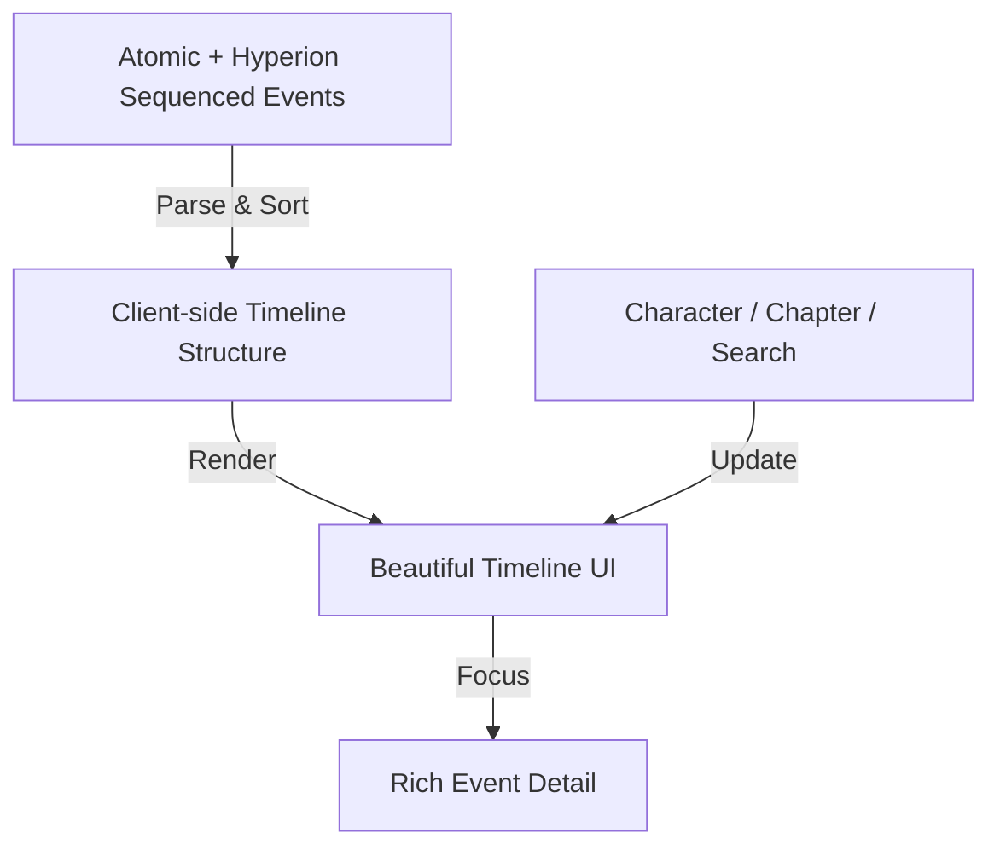

# wax-on-chain-narrative-timeline — On-Chain Narrative Timeline Visualizer

> **Status:** 🔒 Private (In Development) | Target Public Release: August 2026  
> **Category:** Interactive On-Chain Storytelling & Narrative Engines  
> **Parent Catalog:** [pixel-journey/wax-ecosystem-blueprint-catalog](https://github.com/pixel-journey/wax-ecosystem-blueprint-catalog)

**One-sentence goal:** An elegant, interactive timeline visualizer that parses sequenced narrative events, chapters, character arcs, and mutable updates from on-chain data, delivering beautiful storytelling experiences for narrative and world-building projects on WAX.

---

## 1. Overview & Goal

This blueprint turns on-chain narrative data into a living, scrollable or zoomable timeline that feels like a premium story experience.

- **Why it matters for WAX:** Storytelling and lore projects are powerful on WAX. Beautiful timelines make complex narratives accessible, engaging, and shareable.
- **Public infrastructure only:** AtomicAssets for narrative metadata and sequenced events, Hyperion for chronological updates, client-side rendering. No custom contracts.
- **Target users:** Narrative project creators, world-builders, collectors of story-driven NFTs, readers exploring lore.
- **Success metrics:** "Explore a full narrative arc in a beautiful timeline in <5s", "Smooth zoom/scroll and event focus", "Shareable highlighted moments with on-chain proof".

---

## 2. Concepts & Inspiration

- **Core concepts:** Narrative projects store sequenced events, chapters, and updates in Atomic schemas or mutable data. Client aggregates and renders them as an elegant timeline with filtering by character, location, or theme.
- **Pain points:** Lore is often scattered across Discord, docs, or basic lists. Owners want a beautiful, interactive way to experience the story they own pieces of.
- **Inspirations:** TimelineJS, elegant story timelines in games/books, modern web narrative tools. Web3: on-chain provenance + beautiful storytelling UX.
- **Cross-references:** Perfect with `wax-collaborative-lore-timeline`, `wax-interactive-lore-map`, `wax-branching-choose-your-own-adventure`, and other storytelling blueprints. Complements P2P social and generative tools.

---

## 3. Design Specifications (Pixel Journey Standards)

### 3.1 Visual & Interaction Design
- Clean, elegant timeline (vertical or horizontal) with subtle visual hierarchy.
- Cards or nodes for events with rich content (text, images from IPFS, character portraits).
- Interactions: Smooth scroll/zoom, click to focus/expand event, filter by character or chapter.
- Micro-interactions: Gentle animations on load, highlight on hover, satisfying snap to events.
- Responsive: Beautiful on desktop (full timeline); elegant mobile vertical scroll.

### 3.2 Key Views / Components
- `NarrativeTimeline.tsx` — Main interactive timeline component.
- `EventCard.tsx` — Rich card for each narrative event with media and details.
- `TimelineFilters.tsx` — Clean filters for characters, chapters, time periods.
- `FocusModal.tsx` — Expanded view for deep dives into key events.
- `ShareableMoment.tsx` — Export highlighted event or segment with on-chain proof.

### 3.3 Accessibility (A11y) & Inclusive Design
- WCAG 2.2 AA: Keyboard navigation, screen reader announcements for events, high contrast, semantic structure.
- Alternative list or table view for accessibility.
- Reduced motion option.

### 3.4 Performance & Optimization Targets
- Efficient rendering for long timelines (virtualization or pagination).
- Fast initial load with progressive event loading.
- Smooth interactions even with hundreds of events.

---

## 4. Technical Architecture

### 4.1 Core Tech Stack
- Next.js 15 + TypeScript + Tailwind + shadcn/ui + framer-motion
- @tanstack/react-query for narrative data
- AtomicAssets + Hyperion for sequenced events and updates
- date-fns for timeline sorting
- react-virtual or similar for long lists

### 4.2 Data Flow Diagram (Mermaid)


### 4.3 Folder Structure
```
app/
├── (timeline)/[projectId]/page.tsx
├── components/
│   ├── timeline/
│   │   ├── NarrativeTimeline.tsx
│   │   └── EventCard.tsx
│   ├── filters/
│   │   └── TimelineFilters.tsx
│   └── modal/
│       └── FocusModal.tsx
├── hooks/useNarrativeData.ts
├── lib/wax/
│   ├── narrative-parser.ts
│   └── timeline-utils.ts
└── types/narrative.ts
```

### 4.4 Security & Privacy
- Purely public data. Optional shareable moments contain only public event summaries + proof links.

---

## 5. Implementation Examples & Code Snippets

**Core narrative data hook**
```ts
// hooks/useNarrativeData.ts
export function useNarrativeData(projectId: string) {
  return useQuery({
    queryKey: ['narrative', projectId],
    queryFn: async () => {
      const events = await fetchNarrativeEvents(projectId);
      return sortAndGroupEvents(events);
    }
  });
}
```

**Timeline rendering (high-level)**
```tsx
<VirtualizedTimeline
  events={events}
  onEventClick={focusEvent}
  filters={activeFilters}
/>
```

---

## 6. Demo & Testing Strategy
- Demo mode with rich sample narrative data.
- Live mode with real on-chain narrative projects.
- Interaction tests: scroll, filter, focus, share.
- Performance tests for long timelines.

---

## 7. Roadmap & Development Phases
**Phase 0-1:** Data parsing layer (sequenced events from Atomic/Hyperion).
**Phase 2:** Core timeline UI with elegant cards and interactions.
**Phase 3:** Filters, focus modal, shareable moments, polish.
**Phase 4:** Full documentation and catalog update.

**Future:** Integration with branching narratives, collaborative editing views, exportable story PDFs.

---

## 8. Visual References & Mockups
> Beautiful storytelling timelines like those in premium games or narrative apps (e.g. TimelineJS style meets modern web polish). Clean typography, subtle animations, rich media in cards. Reference: high-quality narrative web experiences and game lore timelines.

---

## 9. Related Blueprints & Ecosystem Fit
- `wax-branching-choose-your-own-adventure` & `wax-interactive-lore-map` — Full narrative ecosystem.
- `wax-collaborative-lore-timeline` — Community-contributed layers.
- P2P social and generative blueprints for richer storytelling.

---

## 10. License, Contributing & Credits
- MIT License
- Built for beautiful on-chain storytelling experiences on WAX.
- Thanks to Atomic Hub and Hyperion for reliable public data.
- Pixel Journey Design System for consistent beautiful components.

**This blueprint turns scattered on-chain lore into a living, beautiful story you can explore and share.**

---

**Pixel Journey — Beautiful interfaces for public blockchain data.**
